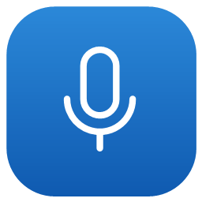

<div align="center">



# LiveListen

**Dictation, live captions, and voice notes for Windows 11**

Speak into the active text field, caption audio playing on your computer, or turn a spoken note into a desktop card.

[简体中文](README.md) · [Download](https://github.com/FueTsui/livelisten/releases/latest) · [Installation](docs/INSTALLATION.md) · [User guide](docs/USAGE.md) · [Speech providers](docs/OFFICIAL_SPEECH_PROVIDERS.md) · [Changelog](CHANGELOG.md)

</div>

**LiveListen runs on Windows 11 x64.** The installer, portable ZIP, and SHA-256 checksums are available on GitHub Releases.

## Features

- **Dictation.** Hold right <kbd>Ctrl</kbd> to speak and release it to finish, or use the continuous dictation shortcut. Choose whether to insert confirmed text only or insert and revise partial results.
- **Live captions.** Transcribe system audio, microphone input, or both. Font size, width, and appearance changes apply immediately.
- **Voice notes and tasks.** Turn a spoken note into a desktop card. Edit it, mark it done, archive it, change its date, or customize its appearance.
- **Voice overlay.** Choose the Nebula or Galaxy animation, drag it into position, and resize it around its center. Text moves above the animation near the bottom of the screen.
- **Speech providers.** Use the built-in Doubao compatibility channel or configure your own credentials for Doubao, OpenAI, Qwen, or Tencent. Optional preconnection can reduce the time to first text.
- **Typing safeguards.** Dictation is blocked in password fields and pauses when the target changes or text cannot be inserted. LiveListen reports whether it could copy any remaining text to the clipboard.
- **System tray.** Close the overlay to keep LiveListen running in the tray. Use **Exit** to quit, or enable startup in Settings.

## Voice animation previews

| Nebula | Galaxy |
| :---: | :---: |
|  |  |

The app's WinUI controls render these previews using simulated audio levels.

## Install or upgrade

Download `LiveListen-Setup-<version>-x64.exe` and `SHA256SUMS.txt` from [GitHub Releases](https://github.com/FueTsui/livelisten/releases/latest) to install LiveListen for your Windows user account. The package includes .NET, the Windows App SDK, and embedded Python. Dictation needs a working microphone and Windows microphone permission. Online speech recognition needs a network connection.

1. Compare the following SHA-256 value with the matching entry in `SHA256SUMS.txt`.

   ```powershell
   Get-FileHash .\LiveListen-Setup-0.1.0-x64.exe -Algorithm SHA256
   ```

2. Run the installer and choose **Install now**. The default path is `%LOCALAPPDATA%\Programs\LiveListen`. Custom options let you change the folder, shortcuts, startup, and whether to launch after installation.
3. Use **Settings → Apps → Installed apps → LiveListen** to uninstall. The uninstaller keeps settings, cards, and credentials by default.

The build is unsigned, so Windows may show a SmartScreen prompt. Verify the source and checksum before running it. Upgrades preserve settings, cards, credentials, and startup and shortcut options. If file replacement fails, the installer restores the previous version.

For portable use, extract the entire `LiveListen-<version>-portable-x64.zip` into a new folder and run `LiveListen.exe` from the extracted files. See the [installation guide](docs/INSTALLATION.md) for silent installation, logs, and exit codes.

## Quick start

Open **Settings** from the tray, select a microphone and speech provider, then put the cursor in a blank text field. Try one of the following shortcuts.

| Default shortcut | Action |
| --- | --- |
| Hold right <kbd>Ctrl</kbd> | Dictate into the active text field. Release to finish. |
| <kbd>Ctrl</kbd>+<kbd>Alt</kbd>+<kbd>Space</kbd> | Start or stop continuous dictation. |
| <kbd>Ctrl</kbd>+<kbd>Alt</kbd>+<kbd>C</kbd> | Toggle live captions. |
| <kbd>Ctrl</kbd>+<kbd>Alt</kbd>+<kbd>N</kbd> | Record a voice note. |
| <kbd>Ctrl</kbd>+<kbd>Alt</kbd>+<kbd>K</kbd> | Show or hide desktop cards. |

Customize the shortcuts in Settings. A single click on the tray icon shows or hides the voice overlay. In the tray context menu, **Show dictation** controls the same setting as **Show live text in the bar**.

### Speech providers

| Provider | Credentials | Default model or engine |
| --- | --- | --- |
| Built-in Doubao compatibility channel | None | Uses a third-party MIT-licensed module. Availability depends on the web service. |
| Doubao official API | API key | `bigmodel` |
| OpenAI | API key | `gpt-live-transcribe` |
| Qwen | API key | `qwen3-asr-flash-realtime`, Beijing or Singapore |
| Tencent | SecretId and SecretKey. Enter the AppId in Settings. | `16k_zh` |

The provider **Check** action validates local configuration and bridge startup. Cloud authentication and recognition require a separate test. See [official provider setup](docs/OFFICIAL_SPEECH_PROVIDERS.md) for endpoints and configuration fields.

### Preconnection

| Mode | Behavior |
| --- | --- |
| Off (default) | Opens a connection when dictation starts. |
| Balanced | Keeps a connection ready for two minutes after dictation and can prepare one while you hold the dictation key. |
| Aggressive | Keeps a connection ready for ten minutes after launch or dictation. |

Preconnection can authenticate with the provider before dictation begins. Audio capture and transmission start with dictation. Preparation pauses after one minute of inactivity in Balanced mode or three minutes in Aggressive mode and resumes when you return.

## Data and privacy

| Data | Where it goes |
| --- | --- |
| Microphone or system audio | Goes to the selected speech provider. Recordings are never saved to disk. Up to 90 seconds may remain buffered in memory during reconnection. |
| Dictation text | Goes to the selected text field. Uninserted text can go to the Windows clipboard, where clipboard history and sync settings apply. |
| Live captions | Recent captions stay in memory. |
| Notes and tasks | `%APPDATA%\LiveListen\cards.json` |
| Settings | `%APPDATA%\LiveListen\settings.json`. Provider credentials are stored separately. |
| Provider credentials | Windows Credential Manager. LiveListen supplies them to the relevant recognition process at startup. |
| Diagnostic logs | `%LOCALAPPDATA%\LiveListen\Logs`. Local events, error codes, and lengths only. |
| Installer logs | `%TEMP%\LiveListen-Setup-<timestamp>.log` or `LiveListen-Uninstall-<timestamp>.log` |
| Update check | Opens the GitHub Releases page when requested. Updates are downloaded and installed manually. |

See the [security policy](SECURITY.md) for more detail.

## Interfaces

The WinUI app calls the Rust core through a JSON C ABI. The core also powers the CLI. The app does not listen on a network port.

| Capability | SDK command | CLI command | Effect |
| --- | --- | --- | --- |
| List devices and providers | `devices`, `providers` | `devices`, `providers` | Read only |
| Check a provider | `provider.check` | `check` | Starts a local bridge process |
| Transcribe once | — | `listen` | Sends audio to the speech provider |
| Settings | `settings.get`, `settings.set` | `config` (read only) | Reads or writes local settings |
| Dictation | `dictation.start/toggle/stop/cancel` | — | Sends audio and types into the target |
| Captions | `captions.toggle/set/lines` | — | Sends audio to the speech provider |
| Desktop cards | `cards.list/add/update/styles.clear/show/delete` | — | Writes local card data. Deletion is permanent. |
| Credentials | `secret.set/delete/status` | — | Uses Windows Credential Manager |
| Diagnostics | `diagnostics.export` | — | Writes a local file |

### SDK

The x64 `livelisten_native.dll` exports these functions. Requests and replies use UTF-8 JSON.

```c
typedef void (*ll_event)(const char *json, void *user);
LLHandle  *ll_start(const char *config_dir /* UTF-8 or NULL */, ll_event callback, void *user);
char      *ll_call(LLHandle *handle, const char *request_json);
void       ll_free(char *text);
void       ll_destroy(LLHandle *handle);
const char *ll_version(void);
```

A request such as `{"cmd":"providers"}` returns a reply with `"ok":true` on success or `"ok":false` and an error code on failure. Free the text returned by `ll_call` with `ll_free`. If `ll_start` fails it returns NULL. Copy the callback text and return promptly because callbacks run on the engine thread. See the [provider bridge protocol](docs/PROVIDER_PROTOCOL.md).

### CLI

Run these commands from the installation directory.

```powershell
.\live-listen.exe devices --json
.\live-listen.exe providers
.\live-listen.exe check --provider doubao
.\live-listen.exe listen --wav .\sample.wav --json
.\live-listen.exe config
```

| Option | Behavior |
| --- | --- |
| Global | `--config DIR` overrides `%APPDATA%\LiveListen`. `--json` emits one ASCII-escaped JSON object per line. `--version` prints the version. |
| `listen` | Accepts `--source mic\|system\|mixed`, `--device NAME`, `--wav PATH` (16 kHz mono PCM16), `--seconds N` (default 10), and `--provider ID`. |
| Exit codes | 0 for success, 1 for a runtime error, 2 for invalid arguments. |
| Timeouts | `check` waits up to 20 seconds for startup. After audio ends, `listen` waits up to eight more seconds for the final result. |

The `listen` command sends audio to the selected provider. For installer and uninstaller flags, see the [installation guide](docs/INSTALLATION.md).

### App launch options

| Argument | Action |
| --- | --- |
| No argument | Show the voice overlay and keep LiveListen in the tray. |
| `--background` | Start in the tray. |
| `--settings` | Open Settings. |
| `--voice-style=orb` or `--voice-style=ribbon` | Select and save the Nebula or Galaxy style. |
| `--quit` | Ask the running instance to save and exit. |

Later launches pass their arguments to the running instance.

### Configuration

The settings file uses schema version 3. Its `dictation.preconnectLevel` accepts `off`, `balanced`, or `aggressive`. On upgrade from schema version 2, the previous enabled preconnection toggle becomes Aggressive. The C ABI and CLI may change during 0.x. See the [changelog](CHANGELOG.md).

| Environment variable | Purpose |
| --- | --- |
| `LIVE_LISTEN_CONFIG_DIR` | Runs an isolated test instance with its own settings, cards, and logs. It skips startup registration and shares Windows Credential Manager with the regular instance. |
| `LIVE_LISTEN_TEST_AUDIO`, `LIVE_LISTEN_TEST_CAPTIONS_AUDIO` | Replace captured audio with a test WAV. The configured provider still receives the audio. |
| `LIVE_LISTEN_DEBUG` | Includes debug lines in the log when set. |
| `SETUP_TEST_ROOT` | Redirects installer files and registry writes into a test folder in Debug builds. |

## Build and verify

Install the Rust MSVC toolchain (1.85 or newer), Visual Studio C++ Build Tools, the Windows SDK, the .NET 10 SDK, Python 3.11 or newer, and PowerShell. Building requires no credential files.

```powershell
.\scripts\build.ps1
cargo fmt --all -- --check
cargo clippy --locked --all-targets -- -D warnings
cargo test --locked -- --skip secrets::tests::store_read_and_delete
python -B -m unittest discover -s providers\tests -v
dotnet run --project app\LiveListen.Checks -c Release
```

The filtered test writes to Windows Credential Manager and is excluded from the pass count.

```powershell
.\scripts\package-portable.ps1 -OutputDirectory .\target\release-check\local-package
```

Choose a new output directory. The packaging script verifies pinned runtime dependencies and creates the installer, portable ZIP, checksums, release manifest, and provenance record. See the [local packaging guide](docs/RELEASE.md).

| Directory | Responsibility |
| --- | --- |
| `crates/live-listen-core/` | Audio, shortcuts, input, speech sessions, settings, credentials, and cards |
| `crates/live-listen-ffi/`, `crates/live-listen-cli/` | C ABI and command-line entry points |
| `app/LiveListen/`, `app/LiveListen.Checks/` | WinUI 3 app and offline UI behavior checks |
| `providers/` | Python speech bridges |
| `setup/`, `scripts/` | Installer, build, packaging, and release checks |

## Platform and validation

Windows 11 x64 is the build and native test platform. A clean Windows installation still needs independent acceptance testing. Windows 10 x64 is unverified. Windows ARM64, macOS, and Linux are unsupported.

The built-in Doubao compatibility channel can stop working if its web service changes. Some combinations of input method, Remote Desktop, and target application still need testing. See [architecture](docs/ARCHITECTURE.md), the [threat model](docs/THREAT_MODEL.md), and [release notes](https://github.com/FueTsui/livelisten/releases). The [Chinese README](README.md#规范例外) lists the project's development-standard exceptions.

## License

Copyright © 2026 FueTsui. All Rights Reserved.

LiveListen is proprietary software with publicly available source. See the [license](LICENSE) and [third-party notices](docs/THIRD_PARTY_NOTICES.md).
